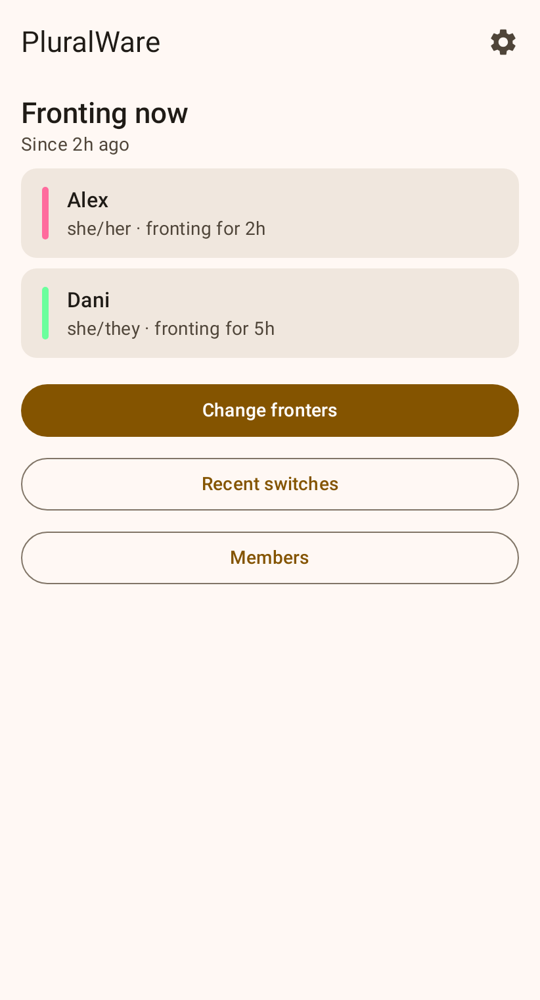
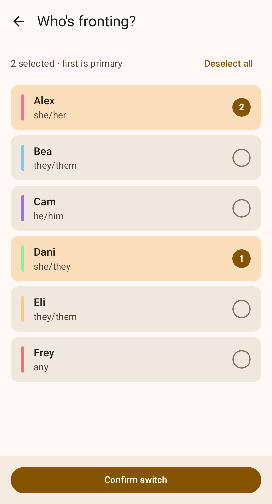
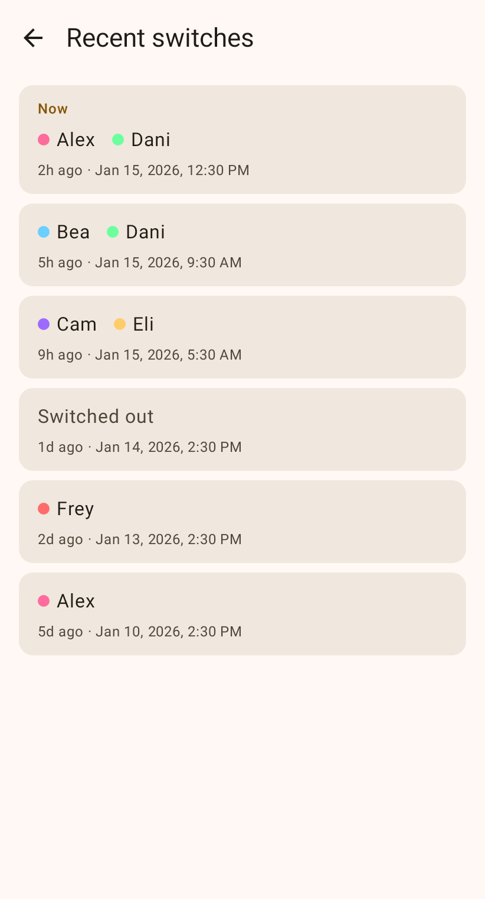
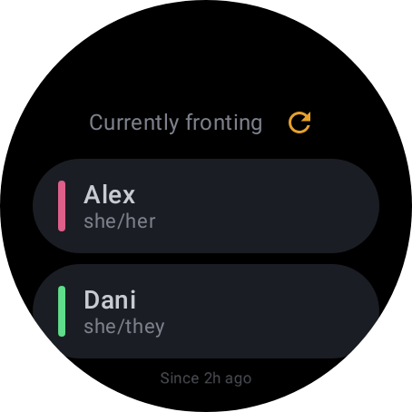
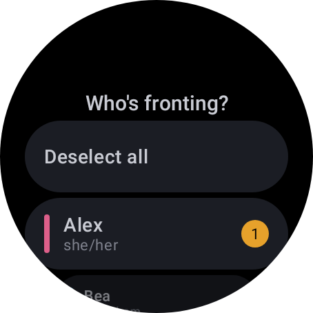
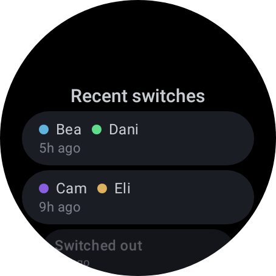

# PluralWare

See and set who's fronting from your phone or your wrist. PluralWare is an
Android and Wear OS app for [PluralKit](https://pluralkit.me) systems. The
watch is optional: the phone app does everything on its own, and lets friends
know when you switch.

  
  
  

  
  
  

It's free, open source (AGPL-3.0) and early: it's being tested with plural
folks now. Bug reports and ideas are welcome in
[Issues](https://github.com/mishan/pluralware/issues).

## What it does

**On your phone, and on your watch if you have one**

- See who's fronting and for how long.
- Change fronters: pick one or more members, or switch out.
- Browse recent switches.

**On your watch**

- Add a **complication** showing the current fronter to your watch face, or
  a **tile** you can swipe to.

**On your phone**

- Connect your PluralKit account, and send it to your watch if you have one.
- **Manage your system**: edit members' names, pronouns, colors and more,
  and fix a switch from History by changing its time or deleting it.
- **Share with friends**: when you switch, friends you choose get a
  notification. You decide which members may be named; anyone else shows up
  as "someone else".
- **Following**: get notified when friends' systems switch.

## What you need

- An **Android phone** (Android 8.0 or later).
- Optionally, a watch running **Wear OS 3 or later**, paired with that phone.
  iPhones can't pair with Wear OS watches.
- A PluralKit system.

## Install

PluralWare isn't on the Play Store. Each
[release](https://github.com/mishan/pluralware/releases) has a phone app
and a watch app. If you use both, install them from the same release.

**Phone**: use [Obtainium](https://github.com/ImranR98/Obtainium), which
keeps it up to date.

1. In Obtainium, tap **Add App** and enter `https://github.com/mishan/pluralware`.
2. Under **Filter APKs by regular expression**, enter `pluralware-mobile`, so
   Obtainium ignores the watch app.
3. Tap **Add**, then install.

**Watch** (optional): download `pluralware-wear-X.Y.Z.apk` from the same release and
install it over wireless debugging, with a Wear OS installer app or `adb`
on a computer:

1. On the watch, turn on **Developer options**: in Settings → System →
   About (sometimes under Versions), tap **Build number** seven times. Then
   turn on **Wireless debugging**. The watch and your phone or computer must
   be on the same Wi-Fi.
2. From a computer: `adb pair IP:PORT` with the pairing code the watch
   shows, then `adb connect IP:PORT` and `adb install pluralware-wear-X.Y.Z.apk`.
3. Turn **Wireless debugging** off again when you're done.

Each release's notes list the signing certificate's SHA-256 fingerprint,
for checking the apps with a tool such as AppVerifier.

## Get started

1. Get your PluralKit token: in any channel the PluralKit bot can see, or in
   a DM with it, send `pk;token`. PluralKit DMs you the token.
2. Open PluralWare on your phone, paste the token and tap **Connect**. It
   shows your current fronters.
3. If you have a watch, open PluralWare on it. The phone sent it your token,
   so it shows your fronters too.

If your watch didn't get the token, keep it near your phone and tap **Send
to watch** under **Settings → Watch** on the phone.

To sign out, tap **Disconnect** in the phone's settings. That signs the watch
out too.
If you regenerate your PluralKit token, the watch asks you to connect again
from your phone.

## Letting friends know when you switch

On your phone, open **Share with friends**, choose **Who may be named**, then
add friends in one of two ways.

**Private (encrypted)**, recommended. Only your friend can read the
notifications.

1. Tap **Invite a friend** and have them scan the QR code, or send them the
   link.
2. They open it in a browser, which works on iPhones and computers too, or
   paste it into **Following** in their own PluralWare.
3. They send you back a **follow code**. Paste it under **Add a friend
   (private)**.

**Simple (ntfy)**, for friends who already use the
[ntfy](https://ntfy.sh) app. You enter an ntfy server and send your friend
the topic to subscribe to. Whoever runs that ntfy server can read the
messages.

By default, friends hear about switches you make **in PluralWare**, on your
phone or your watch. To
include switches made in Discord, on the dashboard or in other apps, you can
host a small [relay](relay/README.md) and connect it under **Share with
friends → Relay**. That takes some technical setup.

## Following friends

**On Android**: open **Following** in PluralWare and paste your friend's
invite. You need a push app to receive notifications; the
[ntfy](https://ntfy.sh) app works. PluralWare gives you a follow code to
send back to your friend.

**On iPhone or a computer**: open the invite link in your browser and follow
the steps. On an iPhone or iPad (iOS 16.4 or later), add the page to your
Home Screen first, as the page explains; only Home Screen web apps can
receive notifications.

## Privacy

- Your PluralKit token is stored encrypted on your phone, and on your watch
  if you have one. It goes from your phone to your watch and to PluralKit,
  and nowhere else. There
  are no accounts, ads or analytics, and nothing is sent to the developers.
- Private notifications are end-to-end encrypted. The push service that
  delivers them can't read them.
- Simple (ntfy) notifications can be read by whoever runs the ntfy server.
- A relay, if you host one, holds your friends' follow codes and the names
  of the members you chose to share. It never holds your PluralKit token.
- Sharing tells friends who's fronting even if your front is private in
  PluralKit. Only the friends you add hear anything.

## For developers

Building, the code layout and design notes are in
[docs/development.md](docs/development.md).

## License

[GNU Affero General Public License v3.0](LICENSE)
